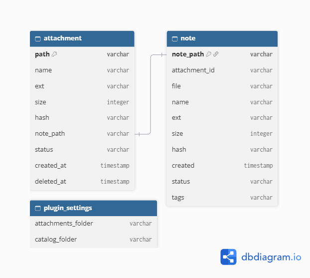

# Модель данных - Smart Attachments

## Сущности

### Attachment (вложение)

Файл в папке `attachments`, для которого создаётся запись в индексе.

<table>
  <thead>
    <tr>
      <th>Поле</th>
      <th>Тип</th>
      <th>Описание</th>
    </tr>
  </thead>
  <tbody>
    <tr>
      <td><code>path</code></td>
      <td>string</td>
      <td>Путь относительно корня vault</td>
    </tr>
    <tr>
      <td><code>name</code></td>
      <td>string</td>
      <td>Имя файла с расширением</td>
    </tr>
    <tr>
      <td><code>ext</code></td>
      <td>string</td>
      <td>Расширение (pdf, jpg, docx)</td>
    </tr>
    <tr>
      <td><code>size</code></td>
      <td>number</td>
      <td>Размер в байтах</td>
    </tr>
    <tr>
      <td><code>hash</code></td>
      <td>string</td>
      <td>SHA-256 хеш содержимого</td>
    </tr>
    <tr>
      <td><code>notePath</code></td>
      <td>string</td>
      <td>Путь к заметке-каталогу</td>
    </tr>
    <tr>
      <td><code>status</code></td>
      <td>string</td>
      <td><code>active</code> или <code>orphan</code> - статус файла</td>
    </tr>
    <tr>
      <td><code>createdAt</code></td>
      <td>string (ISO 8601)</td>
      <td>Дата создания записи</td>
    </tr>
    <tr>
      <td><code>deletedAt</code></td>
      <td>string (ISO 8601)</td>
      <td>Дата удаления (только для <code>orphan</code>)</td>
    </tr>
  </tbody>
</table>

### Note (заметка-каталог)

Markdown-файл в папке `catalog`, который описывает одно вложение.

<table>
  <thead>
    <tr>
      <th>Поле</th>
      <th>Тип</th>
      <th>Описание</th>
    </tr>
  </thead>
  <tbody>
    <tr>
      <td><code>notePath</code></td>
      <td>string</td>
      <td>Путь к .md-файлу</td>
    </tr>
    <tr>
      <td><code>attachment_id</code></td>
      <td>string</td>
      <td>Первые 8 символов хеша (не FK, производное значение)</td>
    </tr>
    <tr>
      <td><code>file</code></td>
      <td>string</td>
      <td>Путь к файлу (дублирует <code>attachment.path</code> для самодостаточности)</td>
    </tr>
    <tr>
      <td><code>name</code></td>
      <td>string</td>
      <td>Имя файла</td>
    </tr>
    <tr>
      <td><code>ext</code></td>
      <td>string</td>
      <td>Расширение</td>
    </tr>
    <tr>
      <td><code>size</code></td>
      <td>number</td>
      <td>Размер в байтах</td>
    </tr>
    <tr>
      <td><code>hash</code></td>
      <td>string</td>
      <td>Полный SHA-256 хеш</td>
    </tr>
    <tr>
      <td><code>created</code></td>
      <td>string (ISO 8601)</td>
      <td>Дата генерации заметки</td>
    </tr>
    <tr>
      <td><code>status</code></td>
      <td>string</td>
      <td><code>active</code> или <code>orphan</code>. Меняется при удалении файла</td>
    </tr>
    <tr>
      <td><code>tags</code></td>
      <td>list</td>
      <td>Теги во фронтматтере (по умолчанию <code>[attachment]</code>)</td>
    </tr>
  </tbody>
</table>

### Index (индекс)

Структура в `data.json`, которая хранит все записи о вложениях.

<table>
  <thead>
    <tr>
      <th>Поле</th>
      <th>Тип</th>
      <th>Описание</th>
    </tr>
  </thead>
  <tbody>
    <tr>
      <td><code>index</code></td>
      <td>Record&lt;string, Attachment&gt;</td>
      <td>Ключ - путь к файлу, значение - запись</td>
    </tr>
    <tr>
      <td><code>settings</code></td>
      <td>object</td>
      <td>Настройки плагина</td>
    </tr>
  </tbody>
</table>

### Settings (настройки)

Singleton-объект в `data.json`, который хранит конфигурацию плагина.

<table>
  <thead>
    <tr>
      <th>Поле</th>
      <th>Тип</th>
      <th>Описание</th>
    </tr>
  </thead>
  <tbody>
    <tr>
      <td><code>attachmentsFolder</code></td>
      <td>string</td>
      <td>Папка с вложениями (по умолчанию <code>attachments</code>)</td>
    </tr>
    <tr>
      <td><code>catalogFolder</code></td>
      <td>string</td>
      <td>Папка для заметок (по умолчанию <code>catalog</code>)</td>
    </tr>
    <tr>
      <td><code>groupByType</code></td>
      <td>boolean</td>
      <td>Раскладывать заметки по подпапкам (по умолчанию <code>true</code>)</td>
    </tr>
  </tbody>
</table>

## Связи

- Один Attachment соответствует одной заметке Note (1:1).
- Один Attachment может иметь ноль или более обратных ссылок из других заметок (1:N) - задел на v2.

## Хранение

Индекс и настройки хранятся в `data.json` в папке плагина: .obsidian/plugins/smart-attachments/data.json

## ERD (диаграмма связей)



Пример содержимого:

```json
{
  "settings": {
    "attachmentsFolder": "attachments",
    "catalogFolder": "catalog"
  },
  "index": {
    "attachments/picture.jpg": {
      "path": "attachments/picture.jpg",
      "name": "picture.jpg",
      "ext": "jpg",
      "size": 245678,
      "hash": "abc123...",
      "notePath": "catalog/picture.md",
      "status": "active",
      "createdAt": "2026-11-02T14:36:00.000Z"
    }
  }
}

Жизненный цикл записи

[создание файла]       → status: active
        ↓
[переименование файла] → status: active (обновлены path и name)
        ↓
[удаление файла]       → status: orphan (добавлен deletedAt)
        ↓
[Delete all orphan notes] → запись удалена из индекса

Ограничения

1.Дубликаты по хешу не создают вторую заметку.
2.Ручное удаление заметки из catalog не синхронизируется с индексом автоматически.
3.Хеш считается для файла любого размера. Для файлов > 100 МБ это может замедлить Obsidian на несколько секунд. В v2 планируется пропускать хеширование для больших файлов
